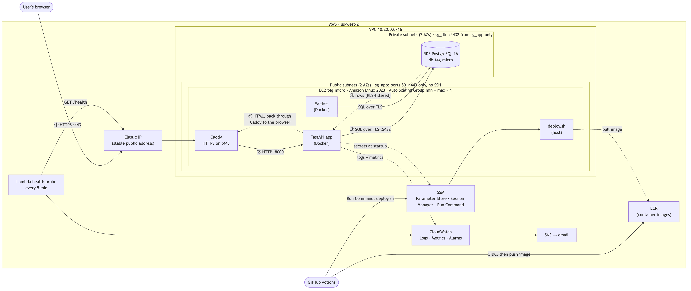

# Roomly

A multi-tenant meeting-room booking app: several organizations share one deployment, and the database itself keeps their data apart and prevents double bookings. The app is deliberately small; the effort went into how it's deployed and run on AWS.

**Live app:** https://roomly.52-26-107-185.sslip.io · **Status page:** https://roomly.52-26-107-185.sslip.io/status · **Health check:** https://roomly.52-26-107-185.sslip.io/health

**Presentation:** the app has a short built-in tour of how it's built and run, at `/tour` ("How it's built" in the header), with live facts from the server that renders it and a button that runs the 50-booking race from your browser.

No sign-up is needed: the landing page has one-click demo logins, and demo data resets nightly.

## Architecture



See [docs/architecture.md](docs/architecture.md) for a walkthrough of how a request travels from the browser to the app and back.

## What it guarantees, and how to check

| # | Guarantee | Enforced by | Verify it |
|---|-----------|-------------|-----------|
| G1 | A room can never be double-booked, even under concurrent requests | Postgres `EXCLUDE` constraint | `python scripts/race.py --base-url <URL> --n 50`: 1 created, 49 conflicts |
| G2 | One organization can't read or change another's data, even if app code has a bug | Row-Level Security + composite foreign keys | `scripts/isolation_demo.sh <URL> <globex_booking_id>`: 404 |
| G3 | The server can be destroyed and replaced with no manual steps | Auto Scaling Group of 1, user data, Elastic IP re-association | Terminate the instance, then watch the footer's instance id change at the same URL |
| G4 | Deploys are automatic, keyless, and roll back by themselves if unhealthy | GitHub Actions, OIDC, SSM Run Command, health-gated `deploy.sh` | Push a broken build ([steps](docs/runbook.md#prove-the-automatic-rollback)) |
| G5 | No inbound SSH, no long-lived credentials, no surprise bills | Session Manager, IAM roles, budget alerts | Inspect `sg_app`; GitHub stores no AWS keys |

## Why I added the optional extras

Each one is here because it backs up a guarantee above, not for its own sake.

- **Terraform:** the whole environment is reviewable and can be rebuilt or destroyed with one command, so "no surprise bills" means `terraform destroy` really does remove everything.
- **CI/CD:** tests and a secret scan run before every deploy. Automatic rollback means a bad push can't take the site down.
- **Docker:** the same image runs in CI and on the server, so replacing the server doesn't change what runs.
- **HTTPS:** session cookies and logins shouldn't cross the internet unencrypted. Caddy makes this free and automatic.
- **Monitoring:** an external probe and budget emails tell me about problems before a user or a bill does.

## Run it locally

Needs Docker and `make`.

```bash
cp .env.example .env
```

Edit `.env` to set your own local passwords, then:

```bash
make up
```

```bash
make db-bootstrap
```

```bash
make migrate
```

```bash
make seed
```

Open http://localhost:8000. Other commands:

```bash
make test
```

```bash
make lint
```

```bash
make race
```

`make test` truncates bookings in the local database, so run `make seed` afterwards. The test suite refuses to run against production.

## Deploy to AWS

The short version, with the details in [the runbook](docs/runbook.md#first-time-setup):

1. Create the S3 bucket for Terraform state, once, by hand.
2. Fill in `infra/terraform.tfvars`, then run `terraform init` and `terraform apply`.
3. Confirm the SNS email, and add the GitHub Actions variables and secrets listed in the runbook. None of them are credentials.
4. Push to `main`. CI runs, then the image is built and pushed.
5. Open a Session Manager shell and run `bootstrap-db.sh` once. It creates the database roles and tables, seeds the demo data and deploys.

After that, every push to `main` deploys itself.

## Security

| What | How |
|------|-----|
| **Open ports** | 80 and 443 on the server. Postgres accepts connections only from the app's security group. There is no port 22 |
| **Human access** | SSM Session Manager, which needs no open port |
| **CI access** | GitHub OIDC gives short-lived credentials, only to `main` of this repository, only for pushing images and running deploys |
| **Server permissions** | An IAM role limited to this ECR repository, `/roomly/prod/*` parameters, and this log group |
| **Secrets** | Generated by Terraform, stored encrypted in SSM. None in the repo, checked by gitleaks in CI |
| **Data** | RDS in private subnets, encrypted at rest. TLS is required, and the app verifies the server's certificate |
| **Web** | HTTPS with HSTS, argon2id passwords, CSRF tokens, a strict Content-Security-Policy, secure cookies |
| **Database roles** | The app connects as a non-owner role with no DELETE permission, and refuses to start if Row-Level Security wouldn't apply |

## Cost

| Resource | Free tier status | Deliberately avoided |
|----------|------------------|----------------------|
| EC2 t4g.micro, 16 GB gp3 | Eligible (verify for your account and free-plan type) | Larger instances |
| RDS db.t4g.micro, 20 GB, single-AZ | Eligible | Multi-AZ, Performance Insights, Enhanced Monitoring |
| Public IPv4 / Elastic IP | Billed hourly outside the free-tier allowance (about $3.60 a month); one address only | Unattached Elastic IPs |
| SSM Parameter Store (standard) | Free | Secrets Manager |
| CloudWatch: logs (7-day), ≤10 alarms, ≤10 custom metrics | Free tier | Synthetics canaries, detailed monitoring |
| Lambda + EventBridge Scheduler | Free tier | |
| ECR | Small storage cost (cents) | |
| | | **NAT Gateway, ALB, Route 53 hosted zone (unless own domain), CloudFront** |

Budget alerts email at $1 actual and $5 forecast. To remove everything:

```bash
make destroy
```

The state bucket was created by hand, so [delete it by hand](docs/runbook.md#tear-down).

## More documentation

- [Architecture and request walkthrough](docs/architecture.md)
- Decision records: [instance type](docs/adr/0001-instance-type.md) · [Linux distribution](docs/adr/0002-linux-distribution.md) · [database](docs/adr/0003-database.md) · [traffic path](docs/adr/0004-traffic-path.md) · [tenant isolation](docs/adr/0005-tenant-isolation.md) · [secrets](docs/adr/0006-secrets.md) · [access and deployment](docs/adr/0007-access-and-deployment.md) · [self-healing](docs/adr/0008-self-healing.md)
- [Postmortem](docs/POSTMORTEM.md)
- [Before real customers](docs/production-readiness.md)
- [Runbook](docs/runbook.md)
