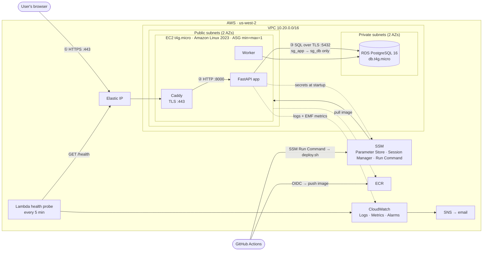

# Roomly: Build Specification

> **For the AI coding assistant reading this:** this is the full spec for the project. Read the whole thing before writing code.
>
> **Ground rules**
> 1. `db/000_bootstrap.sql` and `db/001_init.sql` are **authoritative and tested**. Do not weaken, remove, or "simplify" any constraint, trigger, policy, grant, or role in them. If a change is genuinely needed, add a new migration (`db/002_*.sql`) and explain why.
> 2. The web app **always** connects as `roomly_app`, **never** as `roomly_owner`. The app must refuse to start otherwise (§6.3).
> 3. **No secrets in the repo.** That means no AWS keys, passwords, or session secrets, including in tests, examples, Terraform, or CI. Use `.env` locally (git-ignored) and SSM Parameter Store in AWS.
> 4. Use only the dependencies listed in §3. Ask before adding anything else.
> 5. Work **milestone by milestone** (§20). Each milestone ends with the tests passing and a short summary of what changed.
> 6. Prefer boring, readable code over clever code. The author must be able to explain every line in a video interview.

---

## 1. What we're building

**Roomly** is a multi-tenant meeting-room booking app. Several organizations (tenants) share one deployment. Each organization has its own rooms, users, and bookings, which are completely isolated from other organizations. Employees book rooms in 30-minute slots during their organization's working day.

The project is a DevOps take-home assignment. **The app is deliberately small. The engineering effort goes into correctness guarantees, security, deployment, and operability.**

### 1.1 Headline guarantees (the things the demo will show)
| # | Guarantee | Enforced by |
|---|-----------|-------------|
| G1 | A room can never be double-booked, even under concurrent requests | Postgres `EXCLUDE` constraint `no_double_booking` |
| G2 | One organization can never read or modify another's data, even if app code has a bug | Postgres Row-Level Security + composite foreign keys |
| G3 | The server can be destroyed and replaced with no manual steps | EC2 Auto Scaling Group (size 1) + user data + Elastic IP re-association |
| G4 | Deploys are automatic, keyless, and roll back by themselves if the new version is unhealthy | GitHub Actions + OIDC + SSM Run Command + health-gated deploy script |
| G5 | No inbound SSH, no long-lived credentials, no surprise bills | SSM Session Manager, IAM roles, budget alerts, free-tier-only resources |

### 1.2 Non-goals (do NOT build)
Recurring bookings, calendar sync (Google/Outlook), email invites, payments, self-service org sign-up, password reset, SSO, mobile app, i18n. These are listed in `docs/production-readiness.md` as future work.

---

## 2. Users and roles

| Role | Can do |
|------|--------|
| **employee** | View the day grid, find a free room, book, cancel **own** bookings, check in (stretch) |
| **admin** | Everything an employee can, plus add/edit/deactivate rooms and cancel **any** booking in their org |
| **reviewer** | A person grading the assignment. Uses one-click demo logins on the landing page (§7.1); never has to sign up |

Tenant isolation is enforced **in the database** (RLS). Role permissions (employee vs admin, "own booking") are enforced **in the app**. This split is intentional; document it in an ADR.

---

## 3. Tech stack (fixed)

| Layer | Choice |
|-------|--------|
| Language | Python 3.12 |
| Web framework | FastAPI + Uvicorn |
| Templates | Jinja2, server-rendered HTML |
| Interactivity | **HTMX 2.x**, vendored as a static file (no CDN, no JS build step) |
| CSS | One hand-written `static/app.css` (no framework, no build step) |
| DB driver | `psycopg[binary]` 3.x + `psycopg_pool` |
| Passwords | `argon2-cffi` (argon2id) |
| Sessions | Starlette `SessionMiddleware` (signed cookie, needs `itsdangerous`) |
| AWS SDK | `boto3` (SSM Parameter Store, EC2 instance metadata) |
| Forms | `python-multipart` |
| Tests | `pytest`, `httpx`, `pytest-asyncio` |
| Lint/format | `ruff` |
| Database | PostgreSQL 16 (local: Docker `postgres:16`; AWS: RDS) |
| Reverse proxy / TLS | Caddy 2 (automatic Let's Encrypt) |
| Containers | Docker + Docker Compose (both locally and on EC2) |
| IaC | Terraform ≥ 1.10 (S3 backend with native locking, `use_lockfile = true`) |
| CI/CD | GitHub Actions |

---

## 4. Repository layout

```
roomly/
├── SPEC.md                      # this file
├── README.md
├── Makefile                     # dev shortcuts (see §14)
├── docker-compose.yml           # local dev: postgres + app + worker
├── .env.example                 # local-only placeholders, no real secrets
├── .gitignore                   # includes .env, *.tfstate*, .terraform/
├── .gitleaks.toml
├── app/
│   ├── Dockerfile
│   ├── pyproject.toml
│   ├── roomly/
│   │   ├── __init__.py
│   │   ├── main.py              # FastAPI app factory, middleware, startup checks
│   │   ├── config.py            # settings from env / SSM
│   │   ├── db.py                # pool, tenant_tx(), error mapping
│   │   ├── auth.py              # login, sessions, CSRF, role guards
│   │   ├── timeutil.py          # org-timezone <-> UTC helpers, slot math
│   │   ├── metadata.py          # EC2 IMDSv2 lookup (instance id, AZ, type)
│   │   ├── logging.py           # JSON logs + CloudWatch EMF metrics
│   │   ├── routes/
│   │   │   ├── public.py        # /, /status, demo login
│   │   │   ├── health.py        # /health, /health/live
│   │   │   ├── grid.py          # day grid, find-a-room
│   │   │   ├── bookings.py      # create/cancel/check-in/detail/me
│   │   │   └── admin.py         # rooms admin
│   │   ├── migrate.py           # applies db/NNN_*.sql via psql
│   │   ├── seed.py              # demo data (idempotent, --reset)
│   │   └── worker.py            # no-show release + nightly demo reset
│   ├── templates/               # base.html, partials/*.html, pages/*.html
│   ├── static/                  # htmx.min.js, app.css, favicon
│   └── tests/
├── db/
│   ├── 000_bootstrap.sql        # roles, database, extension (provided, tested)
│   └── 001_init.sql             # schema, RLS, functions (provided, tested)
├── deploy/
│   ├── compose.prod.yml         # app + worker + caddy on EC2
│   ├── Caddyfile
│   ├── deploy.sh                # health-gated deploy with auto-rollback
│   └── user-data.sh.tftpl       # EC2 bootstrap (cloud-init)
├── infra/                       # Terraform
│   ├── backend.tf  providers.tf  variables.tf  outputs.tf
│   ├── network.tf  security.tf   compute.tf    database.tf
│   ├── iam.tf      ecr.tf        ssm.tf        monitoring.tf  budget.tf
│   └── lambda/health_probe.py
├── scripts/
│   ├── race.py                  # concurrency demo (§12.2)
│   ├── isolation_demo.sh        # cross-tenant demo (§12.3)
│   └── bootstrap-db.sh          # one-time DB bootstrap on AWS
├── .github/workflows/
│   ├── ci.yml                   # PRs + main: lint, test, scan, build
│   └── deploy.yml               # main: push image, deploy, smoke test
└── docs/
    ├── architecture.md          # Mermaid diagram + request walkthrough
    ├── adr/0001-…md … 0008-…md  # decision records (§18.2)
    ├── POSTMORTEM.md            # real incident write-up (§18.3)
    ├── production-readiness.md  # "before real customers" table (§18.4)
    └── runbook.md               # deploy, rollback, rotate secrets, teardown
```

---

## 5. Data model

The full schema lives in `db/001_init.sql`. Summary:

```
organizations (id, slug, name, timezone, workday_start, workday_end, created_at)
users         (id, org_id, email, name, role, password_hash, created_at)
rooms         (id, org_id, name, capacity, features[], is_active, created_at)
bookings      (id, org_id, room_id, user_id, title, during tstzrange,
               created_at, checked_in_at, cancelled_at, cancel_reason)
schema_migrations (version, applied_at)
```

### 5.1 Database roles
| Role | Used by | Notes |
|------|---------|-------|
| RDS master / local `postgres` | `000_bootstrap.sql` only | Never used by the app |
| `roomly_owner` | migrations, seed | Owns all tables, so it **bypasses RLS** |
| `roomly_app` | the web app and worker | Not owner, `NOBYPASSRLS`, no DELETE, read-only `organizations`, `statement_timeout=5s` |

### 5.2 Rules enforced by the database (do not duplicate as the *only* check in app code)
| Rule | Mechanism | SQLSTATE | App response |
|------|-----------|----------|--------------|
| No overlapping active bookings per room | `EXCLUDE … no_double_booking` | `23P01` | **409** "That room was just booked by someone else." |
| Start/end on :00 or :30 | CHECK `on_half_hour` | `23514` | 422 |
| Max 4 hours | CHECK `max_four_hours` | `23514` | 422 |
| Within org working hours, same local day | trigger `validate_booking` | `23514` | 422 + trigger message |
| Room must be active | trigger | `23514` | 422 |
| Can't book an already-ended slot | trigger | `23514` | 422 |
| Booking's room and user belong to the same org | composite FKs | `23503` | 404 |
| Rows visible/writable only for current org | RLS policies | n/a (rows simply invisible) | 404 |
| No deletes by the app | grants | `42501` | 500 (bug; should never happen) |

Bookings are **never deleted**. Cancel = set `cancelled_at` + `cancel_reason`. A cancelled booking frees the slot immediately because the exclusion constraint is partial (`WHERE cancelled_at IS NULL`).

Time ranges are half-open `[start, end)` and stored in UTC (`timestamptz`). Convert to and from the org's `timezone` only at the edges (parsing input, rendering output). Put all conversion in `timeutil.py`.

### 5.3 SECURITY DEFINER functions (the only cross-tenant entry points)
| Function | Purpose |
|----------|---------|
| `org_by_slug(slug)` | Resolve `/o/{slug}` to an org before a tenant context exists (login) |
| `health_stats()` | Aggregate counts for `/health`; no tenant data |
| `release_no_shows(grace)` | Worker job: cancel unchecked-in bookings after the grace period (stretch) |
| `rls_enforced_for_current_user()` | Startup self-check (§6.3); not SECURITY DEFINER |

---

## 6. Database access pattern (critical)

### 6.1 The tenant transaction
**Every** query that touches `users`, `rooms`, or `bookings` must run inside `tenant_tx`:

```python
# roomly/db.py
from contextlib import contextmanager

@contextmanager
def tenant_tx(org_id: int):
    with pool.connection() as conn:
        with conn.transaction():
            # set_config(..., true) == SET LOCAL: scoped to THIS transaction only,
            # so a pooled connection never carries one tenant's id into the next request.
            # (SET LOCAL can't take bind parameters; set_config can.)
            conn.execute("SELECT set_config('app.org_id', %s, true)", (str(org_id),))
            yield conn
```

- Never use plain `SET app.org_id` (session-scoped). It would leak between requests on pooled connections.
- Code outside `tenant_tx` may only call `org_by_slug`, `health_stats`, `release_no_shows`, `rls_enforced_for_current_user`, and `SELECT 1`.
- If `app.org_id` is unset, RLS returns zero rows and rejects writes (fail closed). Add a test proving this.

### 6.2 Error mapping
Catch these in one place (`db.py` + an exception handler) and turn them into HTTP responses:
`psycopg.errors.ExclusionViolation → 409`, `CheckViolation → 422` (use `e.diag.message_primary` as the user-facing message), `ForeignKeyViolation → 404`. Every 409 also emits the `BookingConflict` metric (§11.2).

### 6.3 RLS self-check at startup
On startup the app runs `SELECT rls_enforced_for_current_user()`. If the result is not `true`, log a CRITICAL message ("App is connected as a role that bypasses Row-Level Security; refusing to start") and exit with a non-zero code. `/health` also reports this value.

> This exists because the classic RLS mistake is connecting the app as the table owner. Owners bypass RLS, so everything *looks* like it works while isolation is silently off.

### 6.4 Connection pool
`psycopg_pool.ConnectionPool(min_size=1, max_size=5, timeout=3)`. Connection string: `sslmode=verify-full` + `sslrootcert=/app/certs/rds-global-bundle.pem` in AWS (download the RDS CA bundle into the image at build time). Use `sslmode=disable` locally.

---

## 7. Pages and routes

All org-scoped routes are under `/o/{slug}/…`. For every org-scoped request: resolve the slug via `org_by_slug`, then check that the session's `org_id` matches. If it doesn't, redirect to `/o/{slug}/login`.

| Method | Path | Auth | Description |
|--------|------|------|-------------|
| GET | `/` | none | Landing: one-paragraph pitch, **demo login buttons**, link to `/status` |
| POST | `/demo-login` | none, `DEMO_MODE` only | Form fields `slug`, `role` → logs in as that org's seeded demo user |
| GET/POST | `/o/{slug}/login` | none | Email + password login |
| POST | `/logout` | user | Clear session |
| GET | `/o/{slug}/` | user | Redirect → `/o/{slug}/day` |
| GET | `/o/{slug}/day?date=YYYY-MM-DD` | user | **Day grid** (§7.2). Default date: today in org timezone |
| GET | `/o/{slug}/bookings/new?room_id=&start=` | user | HTMX fragment: booking form (title, duration select) |
| POST | `/o/{slug}/bookings` | user | Create. Fields: `room_id`, `start` (ISO local), `duration_minutes`, `title`. Returns the updated grid row fragment (HTMX), JSON when `Accept: application/json` (used by `race.py`), or redirect otherwise. 201 / 409 / 422 |
| GET | `/o/{slug}/bookings/{id}` | user | Booking detail. **Intentionally contains no org check in Python**: `SELECT … WHERE id = %s` inside `tenant_tx`, relying on RLS. Not found → 404. Add a code comment saying so; this route is the isolation demo |
| POST | `/o/{slug}/bookings/{id}/cancel` | owner of booking or admin | Sets `cancel_reason` = `user` or `admin`. Others → 403 |
| POST | `/o/{slug}/bookings/{id}/check-in` | owner of booking | Stretch (§10). Allowed from 10 min before start to 10 min after |
| GET | `/o/{slug}/find?capacity=&duration=` | user | "Find a room now": active rooms with capacity ≥ N that are free from the current half-hour slot for `duration` minutes. Each result has a one-click "Book" button |
| GET | `/o/{slug}/me` | user | My upcoming bookings (not cancelled, `upper(during) > now()`), with cancel buttons |
| GET | `/o/{slug}/admin/rooms` | admin | List rooms, including inactive |
| POST | `/o/{slug}/admin/rooms` | admin | Create room (name, capacity, features checkboxes) |
| POST | `/o/{slug}/admin/rooms/{id}` | admin | Edit room / toggle `is_active` |
| GET | `/health` | none | Readiness JSON (§9) |
| GET | `/health/live` | none | Liveness: `{"status":"ok"}`, no DB call |
| GET | `/status` | none | Human-friendly HTML rendering of `/health` (green/red badges) |

### 7.1 Landing page and demo logins
When `DEMO_MODE=true`, show buttons: **"Acme: employee"**, **"Acme: admin"**, **"Globex: employee"**. Each is a small POST form to `/demo-login`. Also show the line "Demo data resets nightly." When `DEMO_MODE=false`, `/demo-login` returns 404 and the buttons are hidden.

### 7.2 Day grid
- Rows = active rooms (name, capacity, feature icons). Columns = 30-minute slots from `workday_start` to `workday_end` in org local time.
- Booked cells span their duration, show title + booker's first name, and are styled differently if the booking is mine. Past slots are greyed out and not clickable.
- Clicking a free cell does `hx-get` for the booking form fragment and shows it in a small dialog. Submitting does `hx-post`. On success, swap that room's row. On 409/422, show the error inside the dialog and refresh the row (so a conflict immediately shows who got it).
- Header: date with ◀ Today ▶ navigation, org name, user name + role, logout.
- Grid query (inside `tenant_tx`):
  ```sql
  SELECT b.id, b.room_id, b.user_id, b.title, b.during, u.name AS booker
  FROM bookings b JOIN users u ON u.id = b.user_id
  WHERE b.cancelled_at IS NULL AND b.during && tstzrange(%(day_start)s, %(day_end)s)
  ```
- Find-a-room query:
  ```sql
  SELECT r.* FROM rooms r
  WHERE r.is_active AND r.capacity >= %(cap)s
    AND NOT EXISTS (SELECT 1 FROM bookings b
                    WHERE b.room_id = r.id AND b.cancelled_at IS NULL
                      AND b.during && tstzrange(%(start)s, %(end)s))
  ORDER BY r.capacity, r.name
  ```

### 7.3 Footer (every page)
`Served by i-0abc123 · us-west-2a · v1.2.0 (a1b2c3d) · rendered in 12 ms`. Locally, instance shows `local`. This links the live app to the architecture diagram during the demo.

### 7.4 Look and feel
Clean and minimal. System font stack, one accent color (mango orange `#F59E0B`-ish), generous whitespace, works on a laptop screen at 1280px. Accessible: real `<button>`s, labels on inputs, visible focus states, color is never the only signal.

---

## 8. Authentication, sessions, CSRF

- Passwords: argon2id via `argon2-cffi` defaults. Never log passwords or hashes.
- Login: look up the org via `org_by_slug`, then inside `tenant_tx(org.id)` select the user by lowercase email and verify the hash. Use a generic error ("Email or password is incorrect") for both unknown email and wrong password.
- Session cookie (Starlette `SessionMiddleware`): `https_only=True` in AWS, `same_site="lax"`, `max_age=8h`. Payload: `user_id`, `org_id`, `role`, `name`, `csrf`.
- CSRF: generate a random token per session. Every POST must include it as the hidden field `csrf` or the header `X-CSRF-Token` (set on `<body hx-headers='{"X-CSRF-Token": "…"}'>`). Mismatch → 403.
- Security headers via middleware: `Content-Security-Policy: default-src 'self'` (works because HTMX and CSS are self-hosted), `X-Content-Type-Options: nosniff`, `Referrer-Policy: same-origin`, `X-Frame-Options: DENY`. Caddy adds HSTS.

---

## 9. Health checks

### 9.1 `GET /health` (readiness)
```json
{
  "status": "ok",
  "version": "1.2.0",
  "commit": "a1b2c3d",
  "build_time": "2026-11-03T18:22:10Z",
  "uptime_seconds": 5231,
  "instance": { "id": "i-0abc123", "az": "us-west-2a", "type": "t4g.micro" },
  "checks": {
    "database": {
      "status": "ok",
      "latency_ms": 3.4,
      "schema_version": "001_init",
      "rls_enforced": true
    }
  },
  "stats": { "organizations": 2, "bookings_today": 14, "active_bookings_now": 3 }
}
```
- Runs `SELECT 1` (timed), then reads the latest `schema_migrations` version, `rls_enforced_for_current_user()`, and `health_stats()`. Overall DB check timeout: 2 s.
- HTTP **200** if everything is OK. **503** with `"status": "degraded"` and an `"error"` string in the failing check otherwise (e.g. DB unreachable, or `rls_enforced` false).
- `Cache-Control: no-store`. No secrets, hostnames, or connection strings in the output.
- `stats.bookings_today` counts by UTC day; document this.

### 9.2 Instance metadata
`metadata.py` fetches instance id, AZ, and instance type **once at startup** with IMDSv2 (PUT a token, then GET with the header), timeout 1 s. On failure, fall back to `"local"`.
> ⚠️ Docker containers can only reach IMDSv2 if the instance's **metadata hop limit is 2** (the default of 1 drops the response at the container network hop). Terraform sets `http_put_response_hop_limit = 2`. This is a likely troubleshooting story.

---

## 10. Background worker (`python -m roomly.worker`)
A separate container running a simple loop:
- **Every 5 min (stretch, only if `NO_SHOW_RELEASE=true`):** `SELECT release_no_shows('10 minutes')`; log and emit the count as metric `NoShowsReleased`.
- **Daily at 10:00 UTC (only if `DEMO_MODE=true`):** run `seed --reset` logic to restore clean demo data. The reset needs the owner connection, so in DEMO_MODE the worker may read the owner password from SSM. The web app container never gets it.
- Both jobs are idempotent, so running more than one worker is harmless.

---

## 11. Logging and metrics

### 11.1 Logs
JSON lines to stdout, one per request:
`{"ts","level","msg","request_id","method","path","status","duration_ms","org","user_id","instance_id"}`.
`request_id` comes from the incoming `X-Request-ID` header (Caddy sets one) or is generated. It's echoed back in the response header. In AWS, Docker's `awslogs` driver ships logs to the CloudWatch log group `/roomly/prod/app` (7-day retention).

### 11.2 Business metrics via CloudWatch Embedded Metric Format (EMF)
Emit metrics as specially formatted JSON log lines (EMF). CloudWatch extracts them from the logs automatically, so no `PutMetricData` calls or extra IAM are needed. Namespace `Roomly`. Metrics: `BookingCreated`, `BookingConflict` (every 409), `BookingRejected` (every 422), `NoShowsReleased`. Dimensions: none (keeps us within the free 10 custom metrics).

---

## 12. Seed data and demo scripts

### 12.1 `python -m roomly.seed [--reset]` (connects as `roomly_owner`)
Idempotent. `--reset` truncates bookings and recreates them.

| Org | slug | timezone | Users (name / email / role) | Rooms (name, capacity, features) |
|-----|------|----------|-----------------------------|----------------------------------|
| Acme Corp | `acme` | America/Los_Angeles | Alice / alice@acme.test / employee (**demo employee**), Adam / adam@acme.test / admin (**demo admin**), + 4 employees | Mango 6 {projector,video}, Papaya 4 {whiteboard}, Guava 12 {projector,video,whiteboard}, Lychee 2 {phone}, Kiwi 8 {video} |
| Globex Inc | `globex` | America/New_York | Gary / gary@globex.test / employee (**demo employee**), Grace / grace@globex.test / admin, + 2 employees | Boardroom 12 {projector,video}, Huddle 4 {whiteboard}, Focus 1 {} |

- All demo users share the password from env `DEMO_PASSWORD`.
- Bookings: for today (remaining slots only) and the next 4 weekdays, fill ~40% of slots with realistic titles ("1:1", "Sprint planning", "Design review", "Customer call", …), 30–120 min long, random seeded users. Insert one slot at a time and skip slots the trigger rejects (past or outside hours). Use a fixed random seed so data is reproducible.

### 12.2 `scripts/race.py` (concurrency demo, G1)
```
python scripts/race.py --base-url https://<host> --org acme --n 50
```
Logs in as the demo employee, picks the next free half-hour slot in room "Kiwi", fires **N simultaneous** `POST /o/acme/bookings` (`Accept: application/json`) with `asyncio` + `httpx`, then prints:
```
Fired 50 concurrent booking requests for Kiwi 14:00–14:30
  ✅ 201 Created   : 1
  ⛔ 409 Conflict  : 49
  ❗ other         : 0
Database guarantee held: exactly one booking exists for that slot.
```
It exits non-zero if created ≠ 1. It also has a `--cleanup` flag to cancel the booking it created.

### 12.3 `scripts/isolation_demo.sh` (G2)
1. Log in as the Acme employee (cookie jar).
2. Look up a Globex booking id (passed as an argument; the author reads one from Globex's UI).
3. `curl /o/acme/bookings/<globex_id>` → prints the **404**.
4. Print a one-line explanation: the route has no org check in Python; RLS made the row invisible.

---

## 13. Configuration and secrets

| Env var | Local | AWS | Secret? |
|---------|-------|-----|---------|
| `APP_ENV` | `local` | `prod` | no |
| `DATABASE_URL` | from `.env` | built at startup from SSM (`/roomly/prod/db/app_password`) + Terraform-provided host | password yes |
| `MIGRATION_DATABASE_URL` | from `.env` | built in `deploy.sh` migrate step from SSM owner password | yes |
| `SESSION_SECRET` | from `.env` | SSM `/roomly/prod/session_secret` | yes |
| `SSM_PREFIX` | unset | `/roomly/prod` | no |
| `DEMO_MODE` | `true` | `true` (for the assignment) | no |
| `DEMO_PASSWORD` | from `.env` | SSM `/roomly/prod/demo_password` | low |
| `APP_VERSION`, `GIT_SHA`, `BUILD_TIME` | `dev` | baked into the image as build args | no |

- `config.py`: if `SSM_PREFIX` is set, fetch the parameters with `boto3` (`GetParametersByPath`, `WithDecryption=True`) using the **instance role**. Nothing secret is written to disk or into compose files.
- SSM parameters are `SecureString` with the default `aws/ssm` KMS key. Terraform generates them with `random_password`. Note in an ADR that they therefore exist in Terraform state, which is stored in an encrypted, versioned, private S3 bucket.
- **Why not Secrets Manager:** it costs about $0.40/secret/month; Parameter Store standard tier is free. Tradeoff: no built-in automatic rotation. Document this in an ADR.

---

## 14. Local development

`docker-compose.yml`: `postgres:16` (local-only superuser password from `.env`), `app` (port 8000, `--reload`), `worker`.

Makefile targets:
```
make up            # docker compose up -d
make db-bootstrap  # run db/000_bootstrap.sql as local superuser (once)
make migrate       # python -m roomly.migrate (as roomly_owner)
make seed          # python -m roomly.seed
make test          # pytest against the compose postgres
make lint          # ruff check + ruff format --check
make race          # scripts/race.py against localhost
make down
```

`roomly/migrate.py`: list `db/[0-9][0-9][0-9]_*.sql` excluding `000_*`, skip versions already in `schema_migrations` (version = filename stem), apply the rest in order with `psql -v ON_ERROR_STOP=1 -f <file>`. The image installs `postgresql-client`. Each migration inserts its own version row (see the bottom of `001_init.sql`).

**Migration policy:** migrations must be backward compatible with the previous app version (expand → deploy → contract), because rollback (§15.5) rolls back the app image, not the schema.

---

## 15. AWS infrastructure (Terraform, region `us-west-2`)

### 15.1 Resources
| Area | Resources | Notes |
|------|-----------|-------|
| State | S3 bucket (versioned, SSE, public access blocked) as backend, `use_lockfile = true` | Bootstrap the bucket manually once; document in runbook |
| Network | VPC `10.20.0.0/16`; 2 public subnets (2 AZs) for EC2; 2 private subnets (2 AZs) for RDS subnet group; IGW; public route table | **No NAT Gateway** (≈$32/mo). EC2 reaches AWS APIs via its public IP |
| Security groups | `sg_app`: inbound 80, 443 from `0.0.0.0/0` (and `::/0`), **no 22**; egress all. `sg_db`: inbound 5432 **only from `sg_app`** (SG reference, not CIDR); no egress needed | |
| Compute | Launch template: AL2023 **arm64** AMI via SSM public parameter `/aws/service/ami-amazon-linux-latest/al2023-ami-kernel-default-arm64`; `t4g.micro`; gp3 16 GB encrypted root; IMDSv2 **required**, `http_put_response_hop_limit = 2`; instance profile; user data from `deploy/user-data.sh.tftpl`. ASG min = max = desired = 1 across both public subnets, `health_check_type = "EC2"`, tags `App=roomly`, `Env=prod` | Check that `t4g.micro` is free-tier eligible **for your account**; fall back to `t3.micro` (x86) if not, which means switching the AMI and image arch |
| Public IP | One Elastic IP. **User data associates it with the new instance at boot** (`aws ec2 associate-address --allow-reassociation`) so the URL survives instance replacement | |
| Database | RDS PostgreSQL 16, `db.t4g.micro`, 20 GB gp3, single-AZ, `publicly_accessible = false`, `storage_encrypted = true`, backup retention 1 day, `deletion_protection = false` and `skip_final_snapshot = true` (assignment only; ADR), Performance Insights and Enhanced Monitoring **off** (cost). Parameter group sets `rds.force_ssl = 1` | Master password from `random_password` → SSM |
| Registry | ECR repo `roomly`, scan on push, lifecycle: keep last 5 images | Storage cost is cents |
| Parameters | SSM: `/roomly/prod/db/{master,owner,app}_password`, `/roomly/prod/db/host`, `/roomly/prod/session_secret`, `/roomly/prod/demo_password`, `/roomly/prod/image_tag` (String; currently deployed tag) | |
| Logs | CloudWatch log group `/roomly/prod/app`, retention 7 days | |
| Monitoring | See §15.6 | |
| Budget | AWS Budgets: monthly cost budget **$1** (actual > 100%) and **$5** (forecast) → email | |
| Tags | `default_tags { Project = "roomly", Env = "prod", ManagedBy = "terraform" }` | Use these to filter Cost Explorer in the demo |

### 15.2 IAM
**EC2 instance role:**
- `AmazonSSMManagedInstanceCore` (Session Manager + Run Command; replaces SSH)
- ECR pull for the `roomly` repo only, plus `ecr:GetAuthorizationToken`
- `ssm:GetParameter(s)`, `ssm:GetParametersByPath` on `arn:…:parameter/roomly/prod/*` only
- `logs:CreateLogStream`, `logs:PutLogEvents` on the app log group only
- `ec2:AssociateAddress` (for the EIP), `ec2:DescribeAddresses`

**GitHub Actions deploy role (OIDC, no stored keys):**
- Trust: `token.actions.githubusercontent.com`, `aud = sts.amazonaws.com`, `sub = repo:<OWNER>/<REPO>:ref:refs/heads/main`
- ECR push to `roomly` only
- `ssm:SendCommand` limited to document `AWS-RunShellScript` and instances tagged `App=roomly`; `ssm:GetCommandInvocation`, `ssm:ListCommandInvocations`
- `ssm:PutParameter` on `/roomly/prod/image_tag` only
- `autoscaling:DescribeAutoScalingGroups`, `ec2:DescribeInstances`

Terraform itself is applied **from the author's machine**, not CI. That keeps CI's permissions small; explain in an ADR.

### 15.3 User data (`deploy/user-data.sh.tftpl`)
1. `dnf install -y docker postgresql16`; enable and start docker.
2. Install the Docker Compose v2 plugin (AL2023 doesn't ship it): download the arm64 release binary to `/usr/local/lib/docker/cli-plugins/docker-compose`. Pin the version and check its sha256.
3. Associate the Elastic IP with this instance (IMDSv2 for the instance id).
4. Write `/opt/roomly/compose.prod.yml`, `/opt/roomly/Caddyfile`, `/opt/roomly/deploy.sh` (rendered from the repo files by `templatefile`).
5. Read `/roomly/prod/image_tag` from SSM and run `/opt/roomly/deploy.sh <tag>`.
6. Log everything to `/var/log/roomly-bootstrap.log`.

### 15.4 Production compose (`deploy/compose.prod.yml`)
Services: `caddy` (ports 80/443, volume for certs), `app` (Uvicorn, 2 workers, port 8000 internal only), `worker`. App and worker use the same image with env `SSM_PREFIX`, `APP_ENV=prod`, `DB_HOST` (from SSM), `AWS_REGION`, and logging driver `awslogs`. Containers run as non-root, `read_only: true` with a tmpfs `/tmp`, and `restart: unless-stopped`. Docker healthcheck: `/health/live`.

Caddyfile: site address `{$SITE_ADDRESS}`. Use a domain you own if you have one; otherwise `roomly.<EIP-with-dashes>.sslip.io`. Reverse-proxy to `app:8000`, add HSTS, set `X-Request-ID` if absent, gzip.
> ⚠️ Every replacement instance requests a new certificate. Repeatedly terminating instances while testing can hit Let's Encrypt's duplicate-certificate rate limit. Use Caddy's staging CA (`acme_ca https://acme-staging-v02.api.letsencrypt.org/directory`) via an env flag while testing, and switch to production for the final demo.

### 15.5 `deploy/deploy.sh <tag>` (health-gated, auto-rollback)
```
1. PREV = currently running tag (from /opt/roomly/current_tag; may be empty)
2. ECR login; docker pull <repo>:<tag>          (fail → exit 1, nothing changed)
3. Run migrations: docker run --rm <image> python -m roomly.migrate
   (the migrate container fetches the owner password from SSM itself)
4. TAG=<tag> docker compose up -d app worker caddy
5. Poll http://127.0.0.1:8000/health (via docker exec or published loopback port)
   every 2 s for up to 60 s; require HTTP 200 and "commit" == expected sha
6. Success → write <tag> to /opt/roomly/current_tag; exit 0
7. Failure → log "Health check failed, rolling back to PREV";
   TAG=PREV docker compose up -d; exit 1   (CI marks the deploy failed)
```
Idempotent: running it twice with the same tag is safe. Bootstrapping a fresh instance uses the same script.

### 15.6 Monitoring and alerts (keep within free-tier limits: 10 alarms, 10 custom metrics)
| What | How | Alarm → SNS email |
|------|-----|-------------------|
| External health | Lambda `health_probe.py` (Python, 128 MB) on EventBridge Scheduler `rate(5 minutes)`: GETs `https://<site>/health`, publishes `Roomly/HealthCheckOk` (1/0) and `Roomly/HealthLatencyMs` | `HealthCheckOk < 1` for 2 consecutive periods; **missing data = breaching** |
| Instance | `AWS/EC2 StatusCheckFailed` | ≥ 1 for 2 periods |
| Database | `AWS/RDS FreeStorageSpace < 2 GB`; `CPUUtilization > 80%` for 15 min | yes |
| Business | `Roomly/BookingConflict` (from EMF) | Dashboard only; no alarm |
| Cost | Budgets (§15.1) | email |

Subscribe the author's email to an SNS topic `roomly-alerts`. Pass the email in as a Terraform variable; never hardcode it.

### 15.7 One-time database bootstrap
`scripts/bootstrap-db.sh`, run on the instance via **SSM Session Manager**: reads the master/owner/app passwords from SSM, runs `db/000_bootstrap.sql` as master with `psql -v owner_password=… -v app_password=…`, then runs migrations and seed. Document it in the runbook.

### 15.8 Cost guardrails (put this table in the README)
| Resource | Free tier status | Deliberately avoided |
|----------|------------------|----------------------|
| EC2 t4g.micro, 16 GB gp3 | Eligible (verify for your account and free-plan type) | Larger instances |
| RDS db.t4g.micro, 20 GB, single-AZ | Eligible | Multi-AZ, Performance Insights, Enhanced Monitoring |
| Public IPv4 / Elastic IP | Billed hourly outside free-tier allowance; one address only | Unattached EIPs |
| SSM Parameter Store (standard) | Free | Secrets Manager |
| CloudWatch: logs (7-day), ≤10 alarms, ≤10 custom metrics | Free tier | Synthetics canaries, detailed monitoring |
| Lambda + EventBridge Scheduler | Free tier | |
| ECR | Small storage cost (cents) | |
| | | **NAT Gateway, ALB, Route 53 hosted zone (unless own domain), CloudFront** |

`make destroy` → `terraform destroy`. The runbook lists anything created manually (state bucket) that has to be deleted by hand.

---

## 16. CI/CD

### 16.1 `.github/workflows/ci.yml` (on pull_request and push to main)
Jobs (in parallel):
- **lint:** `ruff check`, `ruff format --check`
- **test:** service container `postgres:16`; run bootstrap as superuser (test-only throwaway password defined in the workflow, which is fine because it's ephemeral), migrate, `pytest -q`
- **secrets-scan:** gitleaks over the full history
- **terraform:** `terraform fmt -check -recursive`, `terraform init -backend=false`, `terraform validate`
- **docker-build:** build the image (no push) to catch Dockerfile errors

### 16.2 `.github/workflows/deploy.yml` (on push to main, after CI passes; `concurrency: deploy-prod`, cancel-in-progress false)
1. `runs-on: ubuntu-24.04-arm` (native arm64 build, no QEMU).
2. `aws-actions/configure-aws-credentials` with `role-to-assume` (OIDC; `permissions: id-token: write, contents: read`).
3. Build image with build args `APP_VERSION`, `GIT_SHA=${{ github.sha }}`, `BUILD_TIME`; tag `<sha>`; push to ECR.
4. Find instance(s) with tag `App=roomly` in state running.
5. `aws ssm send-command --document-name AWS-RunShellScript --targets Key=tag:App,Values=roomly --parameters commands=["/opt/roomly/deploy.sh <sha>"]`; poll `get-command-invocation` until done and print its output in the job log.
6. Success → `aws ssm put-parameter --name /roomly/prod/image_tag --value <sha> --overwrite` (so replacement instances boot the new version).
7. External smoke test: `curl -fsS https://<site>/health` and assert `.commit == <sha>` and `.status == "ok"`.
8. Failure at 5 or 7 → job fails (the instance has already rolled itself back).

No AWS access keys are stored in GitHub. Repository variables (not secrets) hold `AWS_ROLE_ARN`, `AWS_REGION`, `ECR_REPO`, `SITE_URL`.

---

## 17. Tests (required)

| File | Must prove |
|------|-----------|
| `test_schema.py` | Overlap rejected (23P01); touching ranges `[9:00,9:30)` + `[9:30,10:00)` OK; cancel frees the slot; working hours, half-hour, 4-hour, past-slot rules (23514); inactive room rejected |
| `test_rls.py` | No tenant context → 0 rows and inserts rejected; Acme context can't SELECT/UPDATE Globex rows (UPDATE affects 0 rows); explicit `org_id` of another org on INSERT is rejected; booking with another org's `room_id` rejected; app role `DELETE` → permission denied; `rls_enforced_for_current_user()` is true for app and false for owner; tenant setting doesn't persist after commit on the same pooled connection |
| `test_concurrency.py` | 50 threads insert the same slot simultaneously (each its own connection and transaction) → exactly 1 success, 49 `ExclusionViolation` |
| `test_routes.py` | Login success/failure; book → 201; double-book → 409 with friendly message; employee cancelling someone else's booking → 403; admin can; admin pages → 403 for employee; POST without CSRF → 403; `/o/acme/bookings/<globex_id>` → 404; session for acme on `/o/globex/day` → redirect to login |
| `test_health.py` | 200 + shape when healthy; 503 + `degraded` when the DB is unreachable (pool pointed at a closed port); `/health/live` 200 without DB |
| `test_startup.py` | App refuses to start when connected as `roomly_owner` |
| `test_timeutil.py` | Slot math across a DST change (e.g. America/Los_Angeles on 2026-11-01): a 9:00 local booking stays 9:00 local on both sides |

---

## 18. Documentation deliverables

### 18.1 `docs/architecture.md`
A Mermaid diagram (GitHub renders it) plus a numbered walkthrough that matches the arrows. Also export a PNG to `docs/architecture.png` for the README. Starting point:


Walkthrough: ① the browser resolves the hostname to the Elastic IP and connects on 443 → Caddy terminates TLS → ② proxies to the app on the instance → ③ the app opens a tenant transaction and queries RDS in a private subnet (reachable only from `sg_app`) → the response travels back the same path. Note what is *not* on the path: no SSH, no NAT, no public DB endpoint.

### 18.2 ADRs (`docs/adr/`), ~10–15 lines each: Context · Options considered · Decision · Tradeoffs accepted
1. EC2 instance type & architecture (t4g.micro Graviton vs t3.micro x86 vs t2.micro)
2. Linux distribution (Amazon Linux 2023 vs Ubuntu 24.04 vs Debian)
3. Database (RDS Postgres vs DynamoDB vs Postgres in Docker on the instance vs SQLite). Key argument: the exclusion constraint and RLS are relational features we rely on
4. Traffic path & TLS (Caddy on instance + EIP vs ALB + ACM vs CloudFront)
5. Tenant isolation (RLS in DB + roles in app vs app-only filtering vs schema-per-tenant vs database-per-tenant)
6. Secrets (SSM Parameter Store vs Secrets Manager vs env files)
7. Access & deployment (SSM Run Command + OIDC vs SSH + stored keys vs CodeDeploy vs ECS)
8. Self-healing (ASG of 1 + EIP re-association vs single instance + CloudWatch auto-recover vs ALB + multi-instance)

### 18.3 `docs/POSTMORTEM.md`
Template for a **real** incident the author hits while building: Summary · Impact · Timeline · Detection · Investigation (including wrong hypotheses ruled out) · Root cause · Fix · Prevention / action items · What I learned. Likely candidates: app connected as owner so RLS was off; IMDSv2 hop limit; SG reference typo making RDS time out; the compose plugin missing on AL2023; Let's Encrypt rate limit; DST off-by-one-hour.

### 18.4 `docs/production-readiness.md` ("before real customers")
A table with columns *Area · Today · Before customers · Rough monthly cost*. Rows: availability (ASG 1 → ALB + ASG ≥ 2 across AZs), database (single-AZ → Multi-AZ, PITR, tested restores), edge (Caddy → ALB/ACM + WAF + CloudFront), secrets (Parameter Store → rotation via Secrets Manager), environments (prod only → staging + prod, separate AWS accounts), deploys (in-place → blue/green or ECS rolling), observability (basic alarms → tracing, SLOs, on-call paging), security (→ GuardDuty, Config, Security Hub, CloudTrail org trail), compliance & backups, auth (→ SSO/SAML), rate limiting, data retention.

### 18.5 README.md outline
1. What it is (2 sentences) + **live link** + demo logins note
2. Architecture image + link to `docs/architecture.md`
3. Headline guarantees table (§1.1) with how to verify each
4. Run locally (copy-paste commands)
5. Deploy to AWS (Terraform steps, one-time DB bootstrap, CI setup)
6. Security summary (ports, IAM, secrets, no SSH)
7. Cost summary (§15.8 table) + teardown
8. Links to ADRs, postmortem, production readiness, runbook

---

## 19. Acceptance criteria (definition of done)
- [ ] Live HTTPS URL works; demo login buttons work for both orgs
- [ ] Booking, cancelling, and find-a-room work; data persists in RDS across app restarts and instance replacement
- [ ] `/health` returns 200 with the full shape; returns 503 when the DB is unreachable
- [ ] `scripts/race.py --n 50` against prod → exactly 1 created, 49 conflicts
- [ ] Cross-tenant fetch → 404; app refuses to start as owner
- [ ] Terminating the EC2 instance → a new one serves traffic at the **same URL** with no manual steps
- [ ] Push to main → deployed automatically; footer and `/health.commit` show the new sha; a deliberately broken build is rolled back automatically
- [ ] Security group has no port 22; RDS not publicly accessible; no AWS keys in GitHub; gitleaks passes
- [ ] Health alarm emails when the site is down; budget alert configured
- [ ] All tests in §17 pass in CI
- [ ] README, diagram, 8 ADRs, postmortem, production-readiness, runbook present

---

## 20. Milestones (build in this order)
1. **Local skeleton:** compose, bootstrap + migrate + seed, `/health`, `/health/live`, startup RLS self-check, footer, JSON logging. Tests: `test_schema`, `test_rls`, `test_concurrency`, `test_health`, `test_startup`.
2. **Core features:** auth + demo login + CSRF, day grid with HTMX booking, cancel, my bookings, find-a-room, admin rooms. Tests: `test_routes`, `test_timeutil`.
3. **Infrastructure:** Terraform for everything in §15 except monitoring; manual first deploy via `deploy.sh`; DB bootstrap via Session Manager. Verify instance replacement keeps the URL.
4. **CI/CD:** `ci.yml`, `deploy.yml`, OIDC role; prove the auto-rollback with a deliberately failing health check.
5. **Monitoring:** EMF metrics, Lambda probe, alarms, SNS, budgets, CloudWatch dashboard.
6. **Docs & demo polish:** README, diagram PNG, ADRs, postmortem, production-readiness, runbook, `race.py`, `isolation_demo.sh`.
7. **Stretch:** check-in + no-show release; self-reported ASG health (a systemd timer calls `aws autoscaling set-instance-health --health-status Unhealthy` after 3 failed `/health/live` checks).
