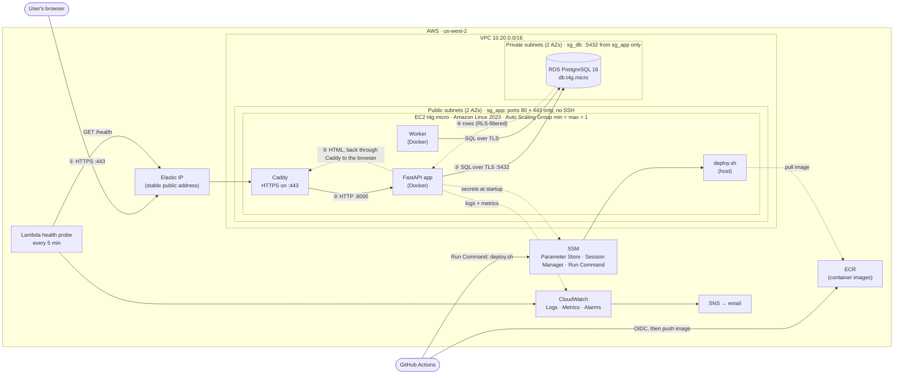

# Architecture

## How a request travels

Numbers match the arrows.

1. **Browser to server.** The hostname resolves to the Elastic IP, a public address that stays the same when the server is replaced. The browser connects on port 443. The `sg_app` security group lets through only ports 80 and 443.
2. **Caddy to the app.** Caddy holds the Let's Encrypt certificate and decrypts HTTPS. It adds a request id and passes the request to the FastAPI container over the private Docker network. Port 8000 isn't published, so the internet can't reach the app directly.
3. **The app to the database.** The app checks the session, opens a transaction, and sets `app.org_id` for that transaction only. It then queries RDS over TLS with certificate verification. RDS sits in a private subnet with no route to the internet, and `sg_db` accepts connections only from `sg_app`.
4. **The database answers.** Row-Level Security filters every row to the current organization, even if the app's query forgot to. A double booking is rejected here by an exclusion constraint.
5. **Back to the browser.** The app renders HTML and the response returns through Caddy. The footer of every page names the instance and commit that served it, so you can match a live page to this diagram.

## What is deliberately not on the path

- **No SSH.** Port 22 is closed. Shell access goes through SSM Session Manager, which is logged and needs no open port.
- **No NAT Gateway.** It costs about $32 a month, and nothing needs it: the instance reaches AWS APIs through its own public IP, and the database needs no outbound access.
- **No public database endpoint.** RDS has `publicly_accessible = false` and no route to the internet.
- **No load balancer.** An ALB costs about $16 a month and would front a single instance. See [ADR 4](adr/0004-traffic-path.md).

## Other flows

- **Deploy.** A push to `main` runs CI. If CI passes, GitHub Actions swaps its OIDC token for short-lived AWS credentials, pushes the image to ECR, and uses SSM Run Command to run `deploy.sh` on the instance. No AWS keys are stored in GitHub. `deploy.sh` runs migrations, starts the new version, and waits for `/health` to report the new commit. If that doesn't happen within 60 seconds, it rolls back.
- **Self-healing.** If the instance dies, the Auto Scaling Group launches another. Its boot script re-attaches the Elastic IP, reads the last good image tag from SSM, and runs the same `deploy.sh`.
- **Monitoring.** Every 5 minutes a Lambda outside the VPC fetches the public `/health`, so DNS, TLS, Caddy, the app and the database must all work for it to pass. Two failures in a row, or the probe going silent, sends an email through SNS.
